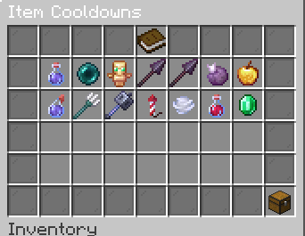
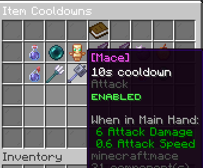
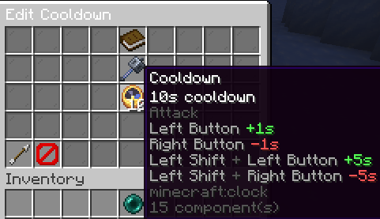
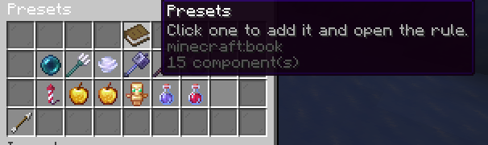
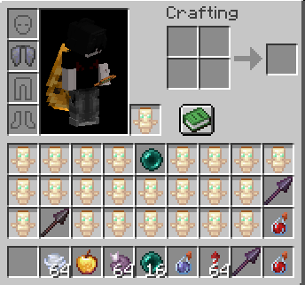
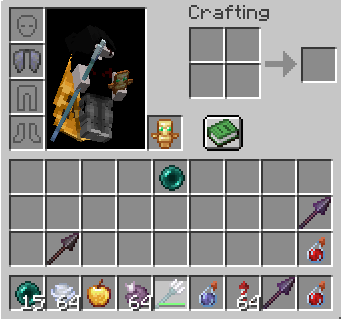
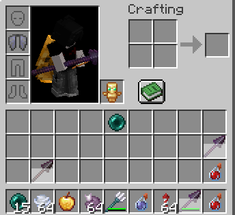
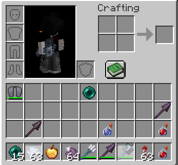

# ItemCooldowns

Per-item cooldowns for **PvP, survival, and minigame servers** — configured in-game with a GUI, stored as **rules** in `config.yml`, and applied only when the item is **actually used** (attack, use, throw, drink, riptide, totem pop, elytra boost, spear lunge, and more).

---

## Requirements

- **Minecraft:** 1.21.11+ (spear / lunge features need spear items on the server)
- **Server:** Paper or Purpur (Paper API)
- **Java:** 21+

### Optional

| Plugin | Purpose |
|--------|---------|
| None required | Works standalone |

---

## Installation

1. Download the latest release from [Modrinth](https://modrinth.com/plugin/itemcooldowns) or [GitHub Releases](https://github.com/mattwhyy/ItemCooldowns/releases)
2. Place `ItemCooldowns-3.0.0.jar` in your server’s `plugins/` folder
3. Restart the server (avoid `/reload`)
4. Run `/itemcooldowns` to open the GUI, or edit `plugins/ItemCooldowns/config.yml`
5. Reload with `/itemcooldowns reload`

Old `cooldowns:` entries in config are **migrated automatically** to the new `rules:` format.

---

# 📋 Rule list & GUI

Every cooldown is a **rule**: one timer, smart matching, and optional filters (potion type, custom model data, item model).

* **Rule list** — see all rules, paging, presets chest, emerald to add from hand
* **Left-click** a rule → open the editor
* **Right-click** a rule → enable or disable (disabled rules are ignored in-game)
* Status shows **ᴇɴᴀʙʟᴇᴅ** / **ᴅɪsᴀʙʟᴇᴅ** on each icon

---

# ⏱️ Edit cooldown time

In the rule editor, use the clock item to set seconds:

* **Left-click** +1s · **Right-click** −1s
* **Shift + left-click** +5s · **Shift + right-click** −5s
* Drop a specific item in the center slot, or use a preset / group rule
* **Auto-saves** when you leave the editor (no save button)

---

# 📦 Presets

One-click presets add a rule and open the editor:

Ender pearl, trident, wind charge, mace, chorus fruit, firework rocket, golden apple, enchanted golden apple, totem of undying, plus grouped **Spear**, **Turtle Master** (10s), and **Instant Health** (5s).

---

# 🧊 Item cooldown overlay

When a rule fires, players get:

* **Action bar** — remaining time when they try to use the item again
* **Hotbar overlay** — white wipe on the item (vanilla-style), including potion groups and custom matches where supported

---

# ⚔️ Combat & utility examples

Cooldowns apply on **real use**, not idle clicks.

| Item / action | When the timer starts |
|---------------|------------------------|
| **Mace** | Melee hit (attack) |
| **Wind charge** | Throw / use |
| **Trident** | Throw or **riptide** |
| **Totem of Undying** | On resurrection |
| **Spear** | **Lunge** only (full charge + Lunge enchant), not normal jabs |
| Potions, pearls, bows, shield, elytra firework, etc. | Matching use event |

### Totem

### Trident (throw & riptide)

### Spear lunge

Grouped spear rules share one timer across all tiers. Includes protection against attribute-swap abuse around lunges.

### Mace & wind charge

---

# 🧪 Grouped rules

Some presets are **one rule, many items**:

| Group | Behavior |
|-------|----------|
| **Spear** | All spear materials · **lunge** timer |
| **Turtle Master** | Drink, splash, lingering · normal / long / strong |
| **Instant Health** | Drink, splash, lingering · normal + strong |

Using any variant in the group starts the **same** cooldown. Potion groups show the overlay on each matching bottle type.

---

# 🎯 Specific rules

Narrow a rule without affecting every copy of the material:

* **Potion type** — e.g. only Turtle Master in a potion bottle
* **Custom model data** — datapack / resource-pack items
* **Item model** — 1.21+ item model keys

The **most specific** matching rule wins (e.g. “mace + CMD 12” does not cooldown other maces).

---

# 🗑️ Removing rules

In the editor, pick up the **barrier** and **drop it outside** the menu → confirm screen → rule removed from config.

---

## Commands

| Command | Permission | Description |
|---------|------------|-------------|
| `/itemcooldowns` | `itemcooldowns.admin` | Open the cooldown GUI |
| `/itemcooldowns reload` | `itemcooldowns.admin` | Reload config and messages |
| `/setcooldown <item> <seconds>` | `itemcooldowns.set` | Add or update a material-wide rule |
| `/getcooldown <item>` | `itemcooldowns.get` | Show configured time for a material |
| `/resetcooldown <item\|all>` | `itemcooldowns.reset` | Remove rule(s) from config |

No command aliases. Namespaced `itemcooldowns:*` suggestions are hidden from the client list.

---

## Permissions

| Permission | Default | Description |
|------------|---------|-------------|
| `itemcooldowns.admin` | OP | GUI and reload |
| `itemcooldowns.set` | OP | `/setcooldown` |
| `itemcooldowns.get` | OP | `/getcooldown` |
| `itemcooldowns.reset` | OP | `/resetcooldown` |

---

## Configuration

| File | Purpose |
|------|---------|
| `plugins/ItemCooldowns/config.yml` | Rule list (`rules:`), schema version |
| `plugins/ItemCooldowns/messages.yml` | GUI and command text (auto-updated by version) |

Rules are saved from the GUI; you can also edit YAML by hand. Use `/itemcooldowns reload` after manual edits.

---

## Contact

---

## Statistics

This plugin uses [bStats](https://bstats.org/) (plugin id **34985**) for anonymous usage stats. Opt out via the global bStats config if you prefer.

---

## Screenshot assets

Store showcase images in the repo folder **`assets/`** (same names as in this README). GitHub and Modrinth render them from there once committed.

| File | Use in README section |
|------|------------------------|
| `rule-list-gui.png` | Rule list & GUI |
| `rule-enable-disable.png` | Enable / disable (right-click) |
| `rule-editor-time.png` | Editing cooldown seconds |
| `presets.png` | Presets menu |
| `item-cooldown-overlay.png` | Hotbar wipe + action bar |
| `totem-cooldown.png` | Totem example |
| `trident-riptide-cooldown.png` | Trident / riptide |
| `spear-lunge-cooldown.png` | Spear lunge |
| `mace-wind-charge-cooldown.png` | Mace & wind charge |

After pushing to GitHub, Modrinth’s long description can use raw links, e.g.  
`https://raw.githubusercontent.com/mattwhyy/ItemCooldowns/main/assets/rule-list-gui.png`  
(replace `main` with your default branch if different).
